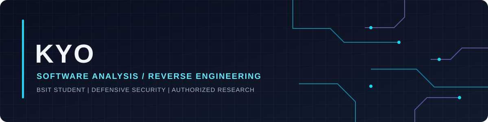

  

<strong>BSIT STUDENT | REVERSE ENGINEERING | SOFTWARE ANALYSIS</strong>

### about

I'm Kyo, a first-year BSIT student at Eastern Visayas State University. I enjoy understanding how software works under the hood and building practical apps and tools. I'm currently learning software analysis and reverse engineering, with an interest in defensive security.

> I focus on authorized analysis, educational research, and defensive learning.

---

### areas of interest

- Software reverse engineering and program analysis
- Defensive security fundamentals and authorized lab work
- Android development and practical developer tools

### technologies

  

- **Languages:** Kotlin, C, C++, Python, JavaScript, PHP, TypeScript
- **Focus:** reverse engineering, software analysis, defensive security

---

### selected projects

- **[Unboxer](https://github.com/Kyouzo/Unboxer)** - A C utility for software analysis and reverse-engineering workflows.
- **[Solace](https://github.com/Kyouzo/Solace)** - An offline-first Android app for private location sharing between two consenting people.
- **[LogicLab](https://github.com/Kyouzo/LogicLab)** - An offline Android app for propositional logic, truth tables, step-by-step evaluation, and practice quizzes.